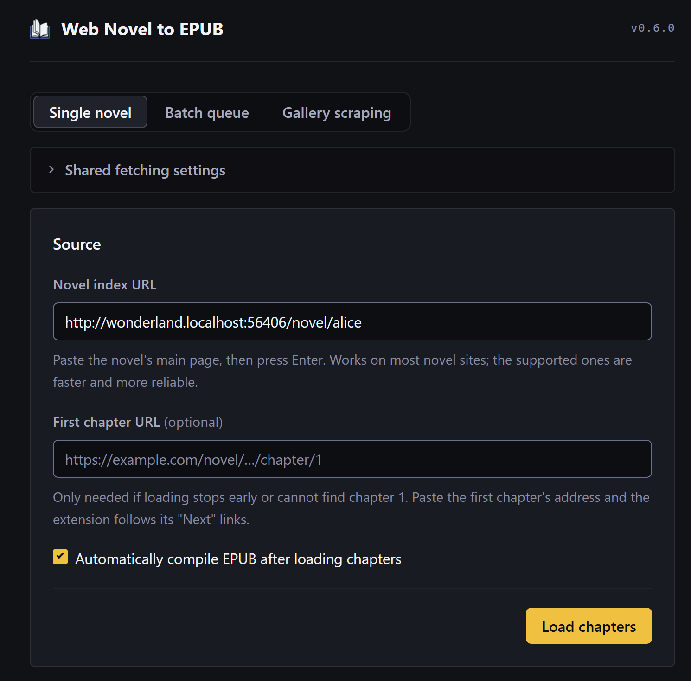
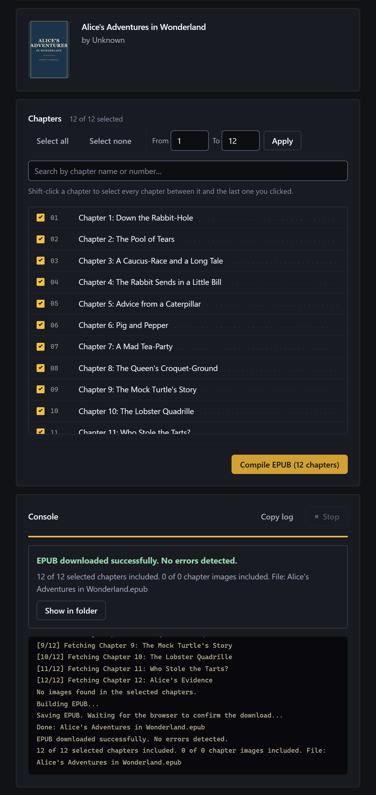
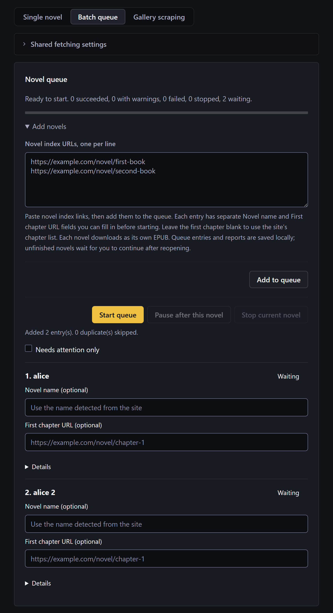
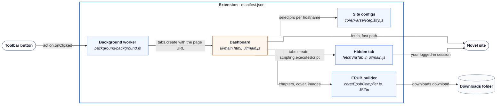

<div align="center">


<h3 align="center">Web Novel to EPUB</h3>

<p align="center">
  A browser extension for Firefox and Chrome that turns web novel chapters into a single EPUB file, cover art and all.
  <br/>
  <br/>
  <a href="https://github.com/TheJaydenProject/webnovel-to-epub/issues/new?template=bug_report.md">Report a Bug</a>
  &nbsp;·&nbsp;
  <a href="https://github.com/TheJaydenProject/webnovel-to-epub/issues/new?template=feature_request.md">Request a Feature</a>
  &nbsp;·&nbsp;
  <a href="https://github.com/TheJaydenProject/webnovel-to-epub/issues/new?template=site_request.md">Request a Site</a>
</p>

[]()
[]()
[]()
[]()
[]()
[]()

</div>

<details>
<summary>Table of contents</summary>

- [About The Project](#about-the-project)
- [Getting Started](#getting-started)
- [Usage](#usage)
- [How It Works](#how-it-works)
- [Supported Sites](#supported-sites)
- [Testing](#testing)
- [Requesting a New Site](#requesting-a-new-site)
- [Roadmap](#roadmap)
- [Contributing](#contributing)
- [License](#license)

</details>

## About The Project

A browser extension for downloading web novels as EPUB files. Give it a TOC page, select your chapters, and it packages the content with cover art and images into a compressed EPUB.

<p align="center">
<picture>
  <source media="(prefers-color-scheme: light)" srcset="images/demo-source-light.png">
  
</picture>
</p>

<p align="center">
<picture>
  <source media="(prefers-color-scheme: light)" srcset="images/demo-chapters-light.png">
  
</picture>
</p>

<p align="center">
<picture>
  <source media="(prefers-color-scheme: light)" srcset="images/demo-queue-light.png">
  
</picture>
</p>

- Reads the TOC page automatically to pull the title, author, chapter list, and cover art without any manual input
- Handles Cloudflare-protected and login-gated sites by loading pages in a real background tab using your existing browser session
- WuxiaWorld users get their API token auto-filled from an open wuxiaworld.com tab
- EPUB output is DEFLATE-compressed at level 9, so file sizes stay small
- Auto-compile is on by default, so there is no need to click Compile after chapters finish loading
- A Stop button lets you bail out early and still get an EPUB with whatever was fetched

60 sites have dedicated support. Any other novel site works too: paste the novel's page and the extension finds chapter 1, the text, and the "Next" links by itself, at a slower and safer pace. More sites are added on request.

### Built With

- [WebExtension APIs (Manifest V3)](https://developer.mozilla.org/en-US/docs/Mozilla/Add-ons/WebExtensions): one codebase for Firefox and Chrome
- [JSZip](https://stuk.github.io/jszip/)

## Getting Started

No build step needed. The same folder loads in Firefox and Chrome.

### Prerequisites

- Firefox 115+ or Chrome 121+ (any current version of either)

### Installation

**Firefox**

1. Go to `about:debugging#/runtime/this-firefox`
2. Click **Load Temporary Add-on...**
3. Select `manifest.json` from this folder

**Chrome / Edge / Brave**

1. Go to `chrome://extensions`
2. Turn on **Developer mode**
3. Click **Load unpacked** and select this folder

The extension icon will appear in your toolbar. On Chrome the icon may be
hidden behind the puzzle-piece menu until you pin it.

### How one manifest covers both

`manifest.json` declares the background entry twice: `service_worker` for
Chromium and `scripts` for Firefox. Each browser reads the key it understands
and ignores the other. `browser-shim.js` aliases `browser` to `chrome` on
Chromium, where the promise-based `browser.*` namespace used throughout this
codebase is not available before Chrome 148.

## Usage

1. Open the novel's main page in your browser (the page that shows its title and chapter list)
2. Click the extension icon. The dashboard opens with that address already filled in
3. Click **Load chapters**. The **First chapter URL** field is only needed if loading stops early or cannot find chapter 1
4. Wait for the chapter list to appear
5. Use **Select all / Select none**, the **From / To** range, or the search box to pick what you want. While searching, the bulk buttons act only on the matching chapters. Shift-click a chapter to select everything between it and the last one you clicked.
6. Click **Compile EPUB** (or let auto-compile handle it)

The EPUB downloads automatically when done. Use **Show in folder** to find it, and **Copy log** to grab the full console output for a bug report. The tab title shows progress, so you can watch a run from another tab. The browser asks before closing the dashboard while a run is in progress. Your fetching toggles are remembered between sessions.

### Queue multiple novels

Choose **Batch queue**, paste one novel index URL per line, click **Add to queue**, then **Start queue**. Use **Single novel** for the original chapter-selection workflow. Shared fetching settings apply to both modes; single-novel auto-compile and chapter ranges do not apply to queued novels.

After adding links, use each entry's separate **First chapter URL** field when the site's index is incomplete. It saves with the queue and can be corrected before retrying. The field locks while that novel is being processed. Invalid URLs show an inline error and must be corrected before starting. The old pipe format remains an optional paste shortcut:

```text
https://example.com/novel/book-one
https://example.com/novel/book-two | https://example.com/novel/book-two/chapter-1
```

Novels are processed one at a time as separate EPUBs. Overall progress and the active novel's chapter/image progress appear above compact result rows. Expand **Details** for source URLs, full counts, filenames, and errors. **Needs attention only** filters to warnings, failures, stopped novels, and paused entries. Invalid entries and failed novels do not stop the other novels. Duplicate URLs are skipped. **Queue retry** schedules a failed, stopped, or warning result for another attempt; click **Start queue** to run it. A retry downloads a new EPUB.

**Pause after this novel** lets the current EPUB finish and leaves the remaining novels waiting. **Stop current novel** stops at the next checkpoint, saves chapters already compiled where possible, and pauses the queue. **Continue queue** processes waiting entries; retry a stopped novel separately if needed. Requests time out after 60 seconds rather than waiting forever.

Queue entries and reports are saved locally. Reloading restores that dashboard's queue; a newly opened dashboard loads the most recently saved queue. Unfinished entries return **paused**, never start automatically, and restart from the beginning when continued. Completed novels are not downloaded again. If the tab closed during a download, check your downloads before restarting that novel. Keep the tab open while processing: saving the queue does not run conversions in the background. Each dashboard owns a separate snapshot so tabs cannot overwrite each other's reports. Storage failures are shown explicitly.

Each batch entry has an optional **Novel name** field for the EPUB title and filename. Leave it blank to use the site's title. Names are saved with the queue and retained on retry. You can edit waiting novels and the novel being discovered; its name locks when conversion starts.

Success means all selected/discovered content was processed without detected errors and the browser confirmed the download. It cannot guarantee that a site's index exposes every chapter. Warning details identify skipped chapters, missing images and cover art, and interrupted chapter discovery.

### Gallery scraping

Choose **Gallery scraping**, enter `https://dreamy-translations.com/series`, and use the folder picker to select your existing EPUB library. Subfolders are included. Click **Scan & download missing novels** to compare the library, check candidates, and automatically process missing novels through the batch queue. Only jobs added by this scan start automatically. Dreamy is the first supported gallery; other gallery URLs produce an explicit error.

**Skip (Hiatus)** and **Only novels with zero premium chapters** are on by default. The scan checks each candidate's novel page, not just gallery badges. Unknown premium counts are skipped, and enabled filters are checked again before a queued novel starts, including retries. Turning the premium filter off does not unlock paid content; inaccessible chapters are reported by the existing conversion workflow.

**Only completed novels** is optional and off by default. When enabled, only novels listed by Dreamy's own **Completed** gallery filter qualify. Completion is verified again before each download, including after restoring or retrying a queue. If the site filter cannot be verified, the scan stops with an error. Having zero premium chapters does not imply completion; the premium and completion filters work independently.

Matching uses normalized full EPUB titles, filenames, and source URLs. New EPUBs include their source URL so renamed books can still match. Corrupt or unusually large EPUBs fall back to filename matching with a visible warning. Old books with custom titles and no matching source metadata may not be recognized. Existing books are skipped entirely, not checked for new chapters.

The selected folder is read locally and never uploaded or modified. Browsers require a folder picker rather than a typed absolute path. Downloads go to your browser's configured download location; set that location to your EPUB folder if you want the new books saved there. Select the library again after reopening the dashboard. For an empty library, use **Start with an empty library**.

The scan reports existing books, queued books, Hiatus titles, premium titles, unverified counts, and failed checks separately. **Stop scan** discards partial scan results without starting downloads. Once downloads start, use the queue's pause, stop, and retry controls. Keep the dashboard open during scanning and downloading.

### Tips

- **Sites behind Cloudflare or a login wall**: "Use browser tab for fetching" is on by default. Just make sure you are logged in to the site before loading.
- **Verification checks ("Just a moment...", CAPTCHAs)**: Cloudflare's automatic check usually finishes by itself, so the extension first waits quietly for up to 15 seconds. If the check needs a person, it brings that tab forward. Complete the check yourself and the run continues automatically; the clearance usually covers the rest of the novel. It waits up to 5 minutes, and Stop cancels the wait. The extension never tries to solve or bypass these checks.
- **Copy-protected readers**: browser-tab fetching reads chapter text rendered inside shadow DOM, and waits for late-loading text instead of reading an empty page.
- **Flaky connections**: network errors and server errors (5xx) are retried twice with short waits before a chapter is reported as failed.
- **Patreon**: paste a collection URL (`patreon.com/collection/...`), which becomes one book in reading order, or a creator's page for every post they made. Sign in to Patreon in the same browser and keep "Use browser tab for fetching" on; posts your membership unlocks are included, and the rest are left out and counted in the report.
- **WuxiaWorld without signing in**: the full chapter list still loads. Free chapters are included and locked ones are reported, instead of saving their preview text.
- **Dreamy Translations notes**: translator's notes are kept and added as a numbered list at the end of each chapter, so the [1], [2] markers in the text have something to point to.
- **Sites with incomplete chapter lists**: fill in the First chapter URL and the extension follows "Next chapter" links through the whole series.
- **WuxiaWorld**: keep a wuxiaworld.com tab open while logged in and the extension fills your API token for you.
- **Stopping early**: click Stop at any point. You still get an EPUB from whatever chapters were fetched.

### Sites not on the list

You do not need to wait for a site to be added. Paste the novel's page into **Novel index URL** and click **Load chapters**:

1. The extension looks on that page for a link such as "Start reading", "Read first", or "Chapter 1". It understands these in English, Chinese, Japanese, Korean, Vietnamese, Russian, Spanish, French, and Indonesian.
2. If you pasted a chapter instead of the novel's page, it starts from that chapter.
3. It reads each chapter, finds the story text, and follows the "Next" link until the story ends or a "Next" link leads back to a chapter it already has.
4. If it cannot find where the story starts, it says so. Open chapter 1 in your browser, copy its address into **First chapter URL**, and click **Load chapters** again.

To avoid getting your account or IP banned on a site nobody has checked yet, the extension:

- Reads one page about every 2.5 to 4 seconds, about twice as slowly as on supported sites, and only speeds up gradually after many clean pages.
- Uses your normal browser tab and login, one page at a time, so the site sees an ordinary reader.
- Pauses on its own when the site says "slow down", stops completely if the site asks for a pause longer than 10 minutes, and never solves or skips CAPTCHAs for you.

If the text comes out wrong or the run stops early, [request the site](https://github.com/TheJaydenProject/webnovel-to-epub/issues/new?template=site_request.md) so it gets a dedicated config.

### Adaptive pacing

Each site gets its own request pace, and the extension learns it as it goes. The goal is to stay fast without getting your IP rate-limited or banned.

| What the site does | What the extension does |
|---|---|
| Answers normally | Every 8 clean pages, waits 10% less between requests. It never goes below half the site's polite default (or 0.5 s). |
| Says "slow down" (HTTP 429, or 503 with `Retry-After`) | Doubles the wait, pauses for as long as the site asks (at least 30 s, growing on repeats), then retries the same chapter on its own. The run continues, and the console notes the pause. |
| Shows a verification check after it had been answering normally | Triples the wait and stops speeding up for the rest of the session. |
| Asks for a pause longer than 10 minutes | Stops sending requests to that site and keeps what was fetched, rather than risk a ban. |

Learned paces are saved locally per site and drift back to the default after 7 days. A site's limit can only be found by exceeding it, and some sites ban on the first breach without a warning. So the extension never probes past its floor: it speeds up slowly and backs off hard. A 503 on the very first request is treated as the site being down, not as a rate limit, so outages fail fast instead of waiting.

### Shared fetching settings

| Option | Default | Description |
|--------|---------|-------------|
| Use browser tab for fetching | On | Loads pages in a real background tab. Required for Cloudflare-protected or login-gated sites |
| Auto-compile after loading | On | Skips the manual Compile step (single-novel mode only) |
| WuxiaWorld API token | Auto | Filled from an open wuxiaworld.com tab |

## How It Works

Everything runs inside your browser; there is no server. The toolbar button opens the dashboard, and the dashboard does all fetching, parsing, and packaging itself.



Each chapter is first requested with a plain `fetch()`. If the page comes back locked, blocked, or empty and browser-tab fetching is on, the same URL is loaded in a hidden background tab, so the site sees your normal session, cookies, and rendered JavaScript. Supported sites have a config in `core/ParserRegistry.js` (title, cover, chapter list, body selectors, pacing); other sites fall back to auto-detection in `core/ContentDetector.js`.

## Supported Sites

Each site below has a dedicated config in `core/ParserRegistry.js`. Dates show the last check against a live novel. Paste the novel's page in either mode. Sites marked "checked in Chrome" sit behind Cloudflare; their selectors were checked in a real browser, because the automated test browser is stopped by the human-verification check.

<details>
<summary>60 supported sites (click to expand)</summary>

| Site | Last verified | Notes |
|---|---|---|
| [wattpad.com](https://www.wattpad.com) | 2026-06-15 | |
| [royalroad.com](https://www.royalroad.com) | 2026-06-15 | |
| [scribblehub.com](https://www.scribblehub.com) | 2026-06-15 | |
| [wuxiaworld.com](https://www.wuxiaworld.com) | 2026-06-14 | Sign in for chapters beyond the free ones |
| [novelbin.com](https://novelbin.com) / [novelbin.me](https://novelbin.me) | 2026-06-15 | |
| [novelbuddy.com](https://novelbuddy.com) | 2026-06-15 | |
| [novelphoenix.com](https://novelphoenix.com) | 2026-11-17 | Formerly novelfire.net |
| [novelarrow.com](https://novelarrow.com) | 2026-06-15 | |
| [novelverse.co](https://novelverse.co) | 2026-06-15 | Formerly novelverse.online |
| [ranovel.com](https://ranovel.com) | 2026-06-15 | |
| [wetriedtls.com](https://wetriedtls.com) | 2026-06-15 | |
| [dreamy-translations.com](https://dreamy-translations.com) | 2026-06-14 | Also supports gallery scraping |
| [dreambigtl.com](https://www.dreambigtl.com) | 2026-06-15 | |
| [fenrirealm.com](https://fenrirealm.com) | 2026-06-15 | |
| [Patreon](https://www.patreon.com) | 2026-11-18 | Paste a collection URL or a creator's page; see Tips |
| [Mistmint Haven](https://www.mistminthaven.com) | 2026-09-19 | Free and Premium chapter lists; sign in for locked chapters |
| [NovelTL](https://noveltl.com) | 2026-09-19 | |
| [WoopRead](https://woopread.com) | 2026-09-19 | Starts at Read Now and follows Next links; keep browser-tab fetching on |
| [mochistar.org](https://mochistar.org) | 2026-11-17 | |
| [oceanstale.com](https://oceanstale.com) | 2026-11-17 | |
| [bailiantales.com](https://bailiantales.com) | 2026-11-17 | |
| [kaystls.site](https://kaystls.site) | 2026-11-17 | |
| [peachpuff.in](https://peachpuff.in) | 2026-11-17 | |
| [readthedrama.com](https://www.readthedrama.com) | 2026-11-17 | |
| [konkon.ink](https://konkon.ink) | 2026-11-17 | |
| [cuttlefishreads.com](https://www.cuttlefishreads.com) | 2026-11-17 | |
| [hostednovel.com](https://hostednovel.com) | 2026-11-17 | Reads every page of the chapter list |
| [lightnovelasia.com](https://lightnovelasia.com) | 2026-11-17 | |
| [noveli.to](https://noveli.to) | 2026-11-17 | |
| [kanunu8.com](https://www.kanunu8.com) | 2026-11-17 | GBK-encoded pages |
| [ixdzs.tw](https://ixdzs.tw) | 2026-11-17 | |
| [empirenovel.com](https://www.empirenovel.com) | 2026-11-17 | |
| [mintteanovel.com](https://mintteanovel.com) | 2026-11-17 | Most chapters need a MintTea account; sign in first |
| [sabertoothtl.com](https://sabertoothtl.com) | 2026-11-18 | Scheduled chapters are left out |
| [starlightnovels.club](https://starlightnovels.club) | 2026-11-18 | |
| [inner-child-reads.com](https://inner-child-reads.com) | 2026-11-18 | Reads every page of the chapter list |
| [dragontl.net](https://dragontl.net) | 2026-11-18 | |
| [novgo.net](https://novgo.net) | 2026-11-18 | |
| [noveljungle.com](https://noveljungle.com) | 2026-11-18 | Coin chapters need an account |
| [ceavan.com](https://ceavan.com) | 2026-11-18 | |
| [hangukhub.com](https://hangukhub.com) | 2026-11-18 | |
| [blume-verse.com](https://blume-verse.com) | 2026-11-18 | |
| [skynovelvault.com](https://skynovelvault.com) | 2026-11-18 | |
| [wntl.net](https://wntl.net) | 2026-11-18 | |
| [deroxzone.com](https://deroxzone.com) | 2026-11-18 | |
| [valvrareteam.net](https://valvrareteam.net) | 2026-11-18 | Vietnamese |
| [m.xsw.tw](https://m.xsw.tw) | 2026-11-18 | Chinese; selectors checked in a browser |
| [uuread.tw](https://www.uuread.tw) | 2026-11-18 | Chinese; joins chapters split over two pages |
| [bllate.org](https://bllate.org) | 2026-11-18 | Russian |
| [ladyhotcombtranslations.com](https://ladyhotcombtranslations.com) | 2026-11-18 | Paste the novel's category page (`/category/novels/...`) |
| [penguin-squad.com](https://penguin-squad.com) | 2026-11-18 | Paid chapters need an account |
| [fancytl.com](https://fancytl.com) | 2026-11-18 | |
| [botitranslation.com](https://www.botitranslation.com) | 2026-11-18 | Same platform as FancyTL; checked in Chrome |
| [theladylovesreading.com](https://theladylovesreading.com) | 2026-11-18 | Paste the book's "Read Now" page (`/series/...`) |
| [sakuraze.vercel.app](https://sakuraze.vercel.app) | 2026-11-18 | Premium chapters are reported, not saved |
| [novelfull.com](https://novelfull.com) | 2026-11-18 | |
| [freewebnovel.com](https://freewebnovel.com) | 2026-11-18 | Checked in Chrome |
| [easternwordsmith.com](https://easternwordsmith.com) | 2026-11-18 | Free chapters only; checked in Chrome |
| [xtruyen.vn](https://xtruyen.vn) | 2026-11-18 | Vietnamese; checked in Chrome |
| [webnovel.com](https://www.webnovel.com) | 2026-11-18 | Free chapters only; paste the book's `/catalog` page; checked in Chrome |

</details>

Chapters that need an account the site has not granted are reported as locked, never saved as empty or preview text. Age or content prompts must be accepted on the site first.

<details>
<summary>Requested sites that are not supported (click to expand)</summary>

| Site | Why |
|---|---|
| comnguoinovel.com | Every chapter needs an account, so the chapter layout could not be checked |
| fictionzone.net | Chapters are reached only through script buttons, with no links to follow |
| zenithtls.com | Chapter text arrives scrambled and is rebuilt by script |
| manta.net | Paid app content |
| novelpia.jp | Needs an account to read |
| sammyandpassion.com | Novels are password-protected by the translator |
| yyuan666.wordpress.com | No chapters on the site; its stories are on Wattpad, which is supported |
| igames.ink | Shows a "Click Allow" notification trap instead of content |
| lunarx.to | Offers whole-file uploads, not chapters |

</details>

## Testing

```powershell
node tests/compile-feedback.mjs   # compile, download, retry, pacing, and image checks
node tests/novel-queue.mjs        # batch queue and gallery controller checks
node tests/rate-limiter.mjs       # adaptive pacing rules
node tests/charset.mjs            # GBK/Big5 pages decoded by their declared charset
node tests/patreon.mjs            # Patreon URLs, reading order, and post rendering
```

Parser fixtures (`tests/*.html`) run in a normal browser: serve the repo folder over HTTP and open each page. Each one shows PASS or FAIL.

**End-to-end:** `tests/e2e` loads the unpacked extension into Chromium. It points the extension at a local fake novel site and inspects the EPUB it downloads. The fake site covers shadow-DOM text, a Cloudflare-style verification check, late-rendered text, icon-only and Korean "next" links, a repeated last chapter, and an image disguised as a font.

```powershell
cd tests/e2e
npm install
npm run setup   # downloads Playwright's Chromium; branded Chrome no longer loads unpacked extensions from the command line
npm test        # set HEADED=1 to watch it run
```

The fake site also returns one HTTP 429, to check that the run pauses, resumes, and still produces a clean EPUB.

**All test commands**, run from `tests/e2e` after the setup above:

| Command | What it checks | Network |
|---|---|---|
| `npm run unit` | Pacing rules, compile and queue logic, site status rules | None, takes seconds |
| `npm test` | The real extension against the local fake site | Local only |
| `npm run live` | The real extension against every supported site | Real sites |

**Live site check.** Run `npm run live` periodically, and always before adding a new site. Add site ids to check only some sites: `npm run live -- royalroad wattpad`.

It first sends one plain request to each site, then runs the extension and compiles the sample novel's first 2 chapters. Each site gets a verdict saying whose fault a problem is:

| Verdict | Meaning | Action |
|---|---|---|
| PASS | Two clean chapters compiled | None |
| DOWN | The site or the novel page answered 5xx, a DNS error, or nothing | The site's fault. Retry later. If it stays down, check whether the site moved. |
| GONE | The site is up, but the sample novel returns 404 | Update `sampleUrls` in `core/ParserRegistry.js` |
| BLOCKED | A check needs a person (a fresh headless profile can't pass it) | Rerun with `HEADED=1` and complete the check yourself |
| LOGIN | Every chapter needs an account, as WuxiaWorld now does even for chapter 1 | Rerun with `HEADED=1`, sign in on the site in that window, then check again |
| FAIL / WARN | The site is up, but the extension failed or got thin text | A real bug to fix |

The command exits with an error only for GONE, FAIL or WARN. It uses a fresh profile with no logins, and it never solves or bypasses verification checks. Full details go to `tests/e2e/live-results.json`.

## Requesting a New Site

[Open a site request](https://github.com/TheJaydenProject/webnovel-to-epub/issues/new?template=site_request.md) and include:

- The novel's index/table-of-contents URL
- A link to a sample chapter page
- Whether the site requires a login to read chapters

## Roadmap

- [x] Chrome / Chromium support
- [ ] More site parsers

See the [open issues](https://github.com/TheJaydenProject/webnovel-to-epub/issues) for a full list of proposed features and known issues.

## Contributing

Contributions are welcome.

1. Fork the project
2. Create a feature branch (`git checkout -b feature/something`)
3. Commit your changes
4. Push to the branch
5. Open a pull request

## License

Distributed under the MIT License. See [LICENSE](LICENSE) for more information.

## Contact

Project link: [github.com/TheJaydenProject/webnovel-to-epub](https://github.com/TheJaydenProject/webnovel-to-epub)
