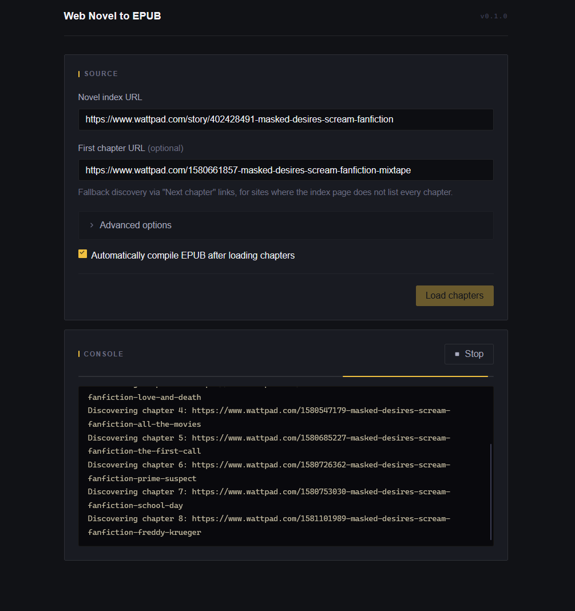
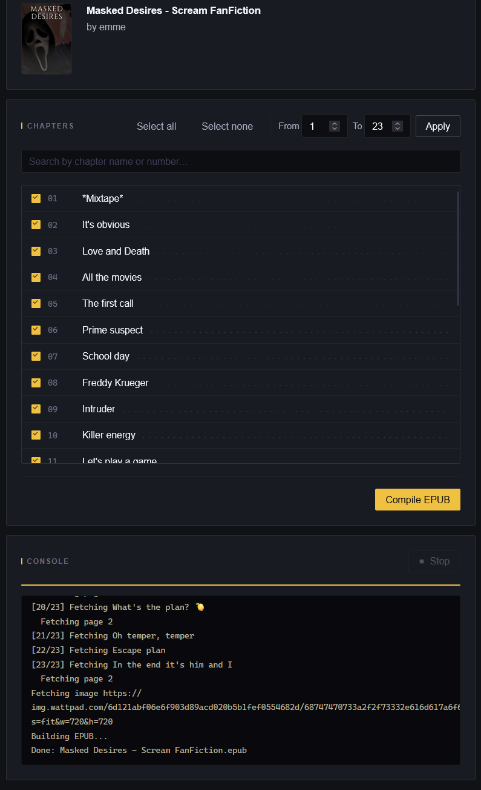

<div align="center">

<h3 align="center">Web Novel to EPUB</h3>

<p align="center">
  A browser extension for Firefox and Chrome that turns web novel chapters into a single EPUB file, cover art and all.
  <br/>
  <br/>
  <a href="https://github.com/TheJaydenProject/webnovel-to-epub/issues/new?template=bug_report.md">Report a Bug</a>
  &nbsp;·&nbsp;
  <a href="https://github.com/TheJaydenProject/webnovel-to-epub/issues/new?template=feature_request.md">Request a Feature</a>
  &nbsp;·&nbsp;
  <a href="https://github.com/TheJaydenProject/webnovel-to-epub/issues/new?template=site_request.md">Request a Site</a>
</p>

</div>

## About The Project





A browser extension for downloading web novels as EPUB files. Give it a TOC page, select your chapters, and it packages the content with cover art and images into a compressed EPUB.

- Reads the TOC page automatically to pull the title, author, chapter list, and cover art without any manual input
- Handles Cloudflare-protected and login-gated sites by loading pages in a real background tab using your existing browser session
- WuxiaWorld users get their API token auto-filled from an open wuxiaworld.com tab
- EPUB output is DEFLATE-compressed at level 9, so file sizes stay small
- Auto-compile is on by default -- no need to click Compile after chapters finish loading
- A Stop button lets you bail out early and still get an EPUB with whatever was fetched

14 sites verified and working. More added on request.

### Built With

- [WebExtension APIs (Manifest V3)](https://developer.mozilla.org/en-US/docs/Mozilla/Add-ons/WebExtensions) — one codebase for Firefox and Chrome
- [JSZip](https://stuk.github.io/jszip/)

## Getting Started

No build step needed. The same folder loads in Firefox and Chrome.

### Prerequisites

- Firefox 115+ or Chrome 121+ (any current version of either)

### Installation

**Firefox**

1. Go to `about:debugging#/runtime/this-firefox`
2. Click **Load Temporary Add-on...**
3. Select `manifest.json` from this folder

**Chrome / Edge / Brave**

1. Go to `chrome://extensions`
2. Turn on **Developer mode**
3. Click **Load unpacked** and select this folder

The extension icon will appear in your toolbar. On Chrome the icon may be
hidden behind the puzzle-piece menu until you pin it.

### How one manifest covers both

`manifest.json` declares the background entry twice — `service_worker` for
Chromium and `scripts` for Firefox. Each browser reads the key it understands
and ignores the other. `browser-shim.js` aliases `browser` to `chrome` on
Chromium, where the promise-based `browser.*` namespace used throughout this
codebase is not available before Chrome 148.

## Usage

1. Open the novel's table-of-contents page in your browser (the series or index page, not a chapter page)
2. Click the extension icon -- the TOC URL fills in automatically
3. Optionally fill in a **First chapter URL** if the TOC does not list every chapter; the extension will walk "Next chapter" links from there
4. Click **Load chapters**
5. Use **Select all / Select none**, the **From / To** range, or the search box to pick what you want. While searching, the bulk buttons act only on the matching chapters. Shift-click a chapter to select everything between it and the last one you clicked.
6. Click **Compile EPUB** (or let auto-compile handle it)

The EPUB downloads automatically when done. Use **Show in folder** to find it, and **Copy log** to grab the full console output for a bug report. The tab title shows progress, so you can watch a run from another tab. The browser asks before closing the dashboard while a run is in progress. Your fetching toggles are remembered between sessions.

### Queue multiple novels

Choose **Batch queue**, paste one novel index URL per line, click **Add to queue**, then **Start queue**. Use **Single novel** for the original chapter-selection workflow. Shared fetching settings apply to both modes; single-novel auto-compile and chapter ranges do not apply to queued novels.

After adding links, use each entry's separate **First chapter URL** field when the site's index is incomplete. It saves with the queue and can be corrected before retrying. The field locks while that novel is being processed. Invalid URLs show an inline error and must be corrected before starting. The old pipe format remains an optional paste shortcut:

```text
https://example.com/novel/book-one
https://example.com/novel/book-two | https://example.com/novel/book-two/chapter-1
```

Novels are processed one at a time as separate EPUBs. Overall progress and the active novel's chapter/image progress appear above compact result rows. Expand **Details** for source URLs, full counts, filenames, and errors. **Needs attention only** filters to warnings, failures, stopped novels, and paused entries. Invalid entries and failed novels do not stop the other novels. Duplicate URLs are skipped. **Queue retry** schedules a failed, stopped, or warning result for another attempt; click **Start queue** to run it. A retry downloads a new EPUB.

**Pause after this novel** lets the current EPUB finish and leaves the remaining novels waiting. **Stop current novel** stops at the next checkpoint, saves chapters already compiled where possible, and pauses the queue. **Continue queue** processes waiting entries; retry a stopped novel separately if needed. Requests time out after 60 seconds rather than waiting forever.

Queue entries and reports are saved locally. Reloading restores that dashboard's queue; a newly opened dashboard loads the most recently saved queue. Unfinished entries return **paused**, never start automatically, and restart from the beginning when continued. Completed novels are not downloaded again. If the tab closed during a download, check your downloads before restarting that novel. Keep the tab open while processing: saving the queue does not run conversions in the background. Each dashboard owns a separate snapshot so tabs cannot overwrite each other's reports. Storage failures are shown explicitly.

Each batch entry has an optional **Novel name** field for the EPUB title and filename. Leave it blank to use the site's title. Names are saved with the queue and retained on retry. You can edit waiting novels and the novel being discovered; its name locks when conversion starts.

Success means all selected/discovered content was processed without detected errors and the browser confirmed the download. It cannot guarantee that a site's index exposes every chapter. Warning details identify skipped chapters, missing images and cover art, and interrupted chapter discovery.

### Gallery scraping

Choose **Gallery scraping**, enter `https://dreamy-translations.com/series`, and use the folder picker to select your existing EPUB library. Subfolders are included. Click **Scan & download missing novels** to compare the library, check candidates, and automatically process missing novels through the batch queue. Only jobs added by this scan start automatically. Dreamy is the first supported gallery; other gallery URLs produce an explicit error.

**Skip (Hiatus)** and **Only novels with zero premium chapters** are on by default. The scan checks each candidate's novel page, not just gallery badges. Unknown premium counts are skipped, and enabled filters are checked again before a queued novel starts, including retries. Turning the premium filter off does not unlock paid content; inaccessible chapters are reported by the existing conversion workflow.

**Only completed novels** is optional and off by default. When enabled, only novels listed by Dreamy's own **Completed** gallery filter qualify. Completion is verified again before each download, including after restoring or retrying a queue. If the site filter cannot be verified, the scan stops with an error. Having zero premium chapters does not imply completion; the premium and completion filters work independently.

Matching uses normalized full EPUB titles, filenames, and source URLs. New EPUBs include their source URL so renamed books can still match. Corrupt or unusually large EPUBs fall back to filename matching with a visible warning. Old books with custom titles and no matching source metadata may not be recognized. Existing books are skipped entirely, not checked for new chapters.

The selected folder is read locally and never uploaded or modified. Browsers require a folder picker rather than a typed absolute path. Downloads go to your browser's configured download location; set that location to your EPUB folder if you want the new books saved there. Select the library again after reopening the dashboard. For an empty library, use **Start with an empty library**.

The scan reports existing books, queued books, Hiatus titles, premium titles, unverified counts, and failed checks separately. **Stop scan** discards partial scan results without starting downloads. Once downloads start, use the queue's pause, stop, and retry controls. Keep the dashboard open during scanning and downloading.

### Tips

- **Sites behind Cloudflare or a login wall** -- "Use browser tab for fetching" is on by default. Just make sure you are logged in to the site before loading.
- **Sites with incomplete TOC pages** -- fill in the First chapter URL and the extension follows "Next chapter" links through the whole series.
- **WuxiaWorld** -- keep a wuxiaworld.com tab open while logged in and the extension fills your API token for you.
- **Stopping early** -- click Stop at any point. You still get an EPUB from whatever chapters were fetched.

### Advanced Options

| Option | Default | Description |
|--------|---------|-------------|
| Use browser tab for fetching | On | Loads pages in a real background tab -- required for Cloudflare-protected or login-gated sites |
| Auto-compile after loading | On | Skips the manual Compile step |
| WuxiaWorld API token | Auto | Filled from an open wuxiaworld.com tab |

## Supported Sites

**Mistmint Haven is supported.** Paste a `/novels/...` novel URL in either mode. Browser rendering is used automatically, including both Free and Premium chapter lists, duplicate removal, and numeric chapter/volume ordering. Covers and available chapter images use the existing image pipeline and warning reports. Chapters requiring access are reported as failures; sign in on the site with the necessary access before retrying. Content/age prompts must be handled on the site by the user. Live index and chapter markup and cover retrieval were checked on 2026-09-19; browser fixtures cover discovery, locked chapters, rendering timeouts, and image handling. This is not a full-novel live conversion verification.

**NovelTL is supported.** Paste its `/series/...` index URL in either mode. Chapters are sorted into reading order, with covers and available inline/lazy-loaded images included. Failed images appear in the completion report. Live metadata, chapter lists, and chapter bodies were checked on two novels on 2026-09-19; image packaging is covered by browser fixtures (the sampled live chapters contained no inline images).

**WoopRead is also supported.** Use its `/series/...` index URL in either mode. The parser starts at **Read Now** and follows **Next** links, since the index initially shows only a short preview of the chapter list. Keep browser-tab fetching enabled for client-rendered pages. Covers and available inline/lazy-loaded images are included; missing or failed image URLs appear in the novel's warning report. Live markup and cover retrieval were checked on 2026-09-19; EPUB image packaging was verified with browser fixtures.

<details>
<summary>14 verified sites -- click to expand</summary>

Sites are configured in `core/ParserRegistry.js`. All of these have been tested end-to-end and produced a working EPUB.

- [wattpad.com](https://www.wattpad.com) - last verified 2026-06-15
- [royalroad.com](https://www.royalroad.com) - last verified 2026-06-15
- [scribblehub.com](https://www.scribblehub.com) - last verified 2026-06-15
- [wuxiaworld.com](https://www.wuxiaworld.com) - last verified 2026-06-14
- [novelbin.com](https://novelbin.com) / [novelbin.me](https://novelbin.me) - last verified 2026-06-15
- [novelbuddy.com](https://novelbuddy.com) - last verified 2026-06-15
- [novelfire.net](https://novelfire.net) - last verified 2026-06-15
- [novelarrow.com](https://novelarrow.com) - last verified 2026-06-15
- [novelverse.online](https://novelverse.online) - last verified 2026-06-15
- [ranovel.com](https://ranovel.com) - last verified 2026-06-15
- [wetriedtls.com](https://wetriedtls.com) - last verified 2026-06-15
- [dreamy-translations.com](https://dreamy-translations.com) - last verified 2026-06-14
- [dreambigtl.com](https://www.dreambigtl.com) - last verified 2026-06-15
- [fenrirealm.com](https://fenrirealm.com) - last verified 2026-06-15

</details>

## Requesting a New Site

[Open a site request](https://github.com/TheJaydenProject/webnovel-to-epub/issues/new?template=site_request.md) and include:

- The novel's index/table-of-contents URL
- A link to a sample chapter page
- Whether the site requires a login to read chapters

## Roadmap

- [x] Chrome / Chromium support
- [ ] More site parsers

See the [open issues](https://github.com/TheJaydenProject/webnovel-to-epub/issues) for a full list of proposed features and known issues.

## Contributing

Contributions are welcome.

1. Fork the project
2. Create a feature branch (`git checkout -b feature/something`)
3. Commit your changes
4. Push to the branch
5. Open a pull request

## License

Distributed under the MIT License. See [LICENSE](LICENSE) for more information.

## Contact

Project Link: [https://github.com/TheJaydenProject/webnovel-to-epub](https://github.com/TheJaydenProject/webnovel-to-epub)
